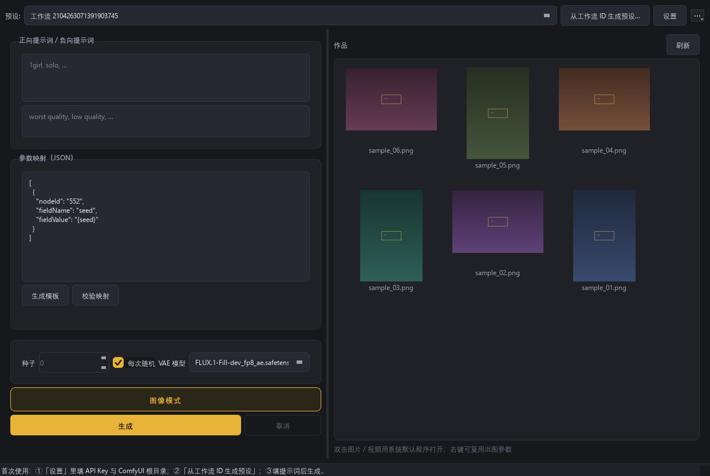
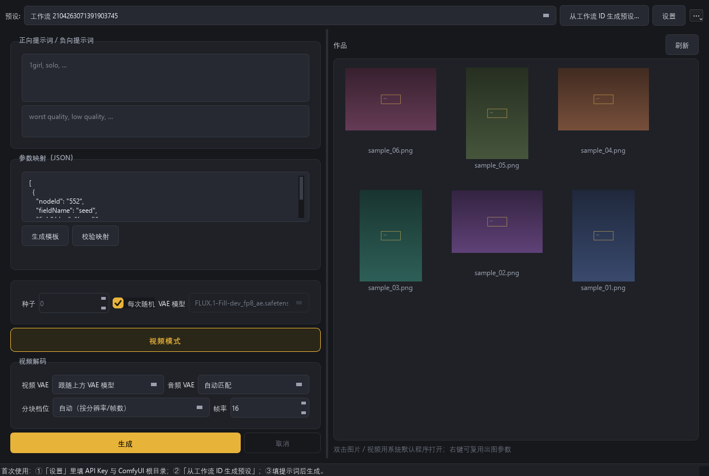
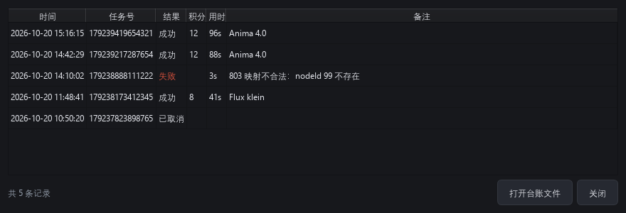

# ComfyUI-RunningHub-Latent

[](https://github.com/liangqi789654258-pixel/ComfyUI-RunningHub-Latent/actions/workflows/tests.yml)


把 **RunningHub 云端当作远程采样器** 用：云端跑完采样后只回传 latent，
**VAE 解码全部在本地完成**，最终输出 ComfyUI 原生 `LATENT`。

```
本地画布  ──▶  提交任务到 RunningHub  ──▶  云端采样，产出 latent 二进制
                                              │
本地 VAE 解码 ◀── 标准 LATENT ◀── 下载 + 解析 ◀┘
```

## 这个插件解决什么问题

| 场景 | 传统做法 | 用本插件 |
|------|---------|---------|
| 本地显卡跑不动大模型 | 全套工序上云，云端出图 | 只把采样交给云端，算力大头卸出去 |
| 想换 VAE 试画质 | 受限于云端工作流固定的 VAE | 本地任意 VAE，随时换 |
| 本地不放十几 GB 底模 | 必须下载 checkpoint | 本地只需要一个 VAE |
| 重复跑同一组参数 | 每次都扣费 | 本地 latent 缓存，重复的零成本重放 |

> **关于云端出图环节**：RunningHub 平台会对最终生成的图像/视频做内容审核。
> 如果云端工作流末端接的是「保存Latent」而非「保存图像」，平台流程就停在 latent 阶段。
> 这是本插件采用该架构的技术副作用，而非本插件植入的功能——本插件没有任何
> 伪装、对抗或规避检测的代码。请务必遵守当地法律法规与 RunningHub 平台规则。

## 安装

```bash
cd ComfyUI/custom_nodes
git clone https://github.com/liangqi789654258-pixel/ComfyUI-RunningHub-Latent.git
cd ComfyUI-RunningHub-Latent
pip install -r requirements.txt
```

重启 ComfyUI，在节点列表里搜索 **RunningHub** 分类即可看到 6 个节点。

> 三个依赖（requests / safetensors / numpy）在标准 ComfyUI 环境中都已存在，
> 这一步通常只会提示「已满足」。

## 仓库里的两个东西

本仓库同时提供两种用法，**共用同一份 `core/` 实现**（不是两份代码）：

| 目录 | 是什么 | 适合 |
|---|---|---|
| 根目录 | ComfyUI 插件：在画布上拖节点出图 | 已经在用 ComfyUI 的人 |
| [`desktop/`](desktop/README.md) | 独立出图器（PySide6 桌面程序，**不用打开 ComfyUI**） | 只想填参数出图、不想搭画布的人 |

桌面版复用 ComfyUI 自带的 Python 环境（`desktop/install.bat` 会自动找），
不需要另装 torch。它的 API Key 存在自己的 `desktop/data/app_config.json`，
**不会**去读插件的 `config.ini`——两边各配一次，这是故意的：
公开程序不做「从别处默默捞 Key」这种隐式路径。
（设置里有一键「从插件 config.ini 导入」按钮，想省事就点它，但那是显式操作。）

### 界面预览

| 图像模式 | 视频模式 |
|---|---|
|  |  |



> 截图里的作品是程序生成的占位色块，不是任何人的实际产出。

**桌面版还做了什么**

- **启动自检**：ComfyUI 路径 / 插件目录 / VAE / ffmpeg / Key 一次查完，缺哪项直接给修复入口
  （新用户最容易卡在这四项，以前得挨个踩一遍才知道）
- **任务台账**：每次云端调用都落一条 jsonl，界面里可看时间 / 任务号 / 积分 / 耗时 / 失败原因
- **成本护栏**：设一个每日积分上限，超过后生成前先确认（按台账统计当日消耗）
- **系统托盘 + 通知**：出视频要等几分钟，最小化后完成 / 失败会弹系统通知
- **按 taskId 续取**：超时、断网、手滑关窗口都能把已付费的结果捞回来，不重新提交
- **命令行可跑**：`desktop/` 下 9 个测试脚本全部离线，不花积分、不碰 GPU

## 快速开始

### 第一步：准备云端工作流（最关键）

在 [runninghub.cn](https://www.runninghub.cn) 上编辑你的工作流，重点是末端：

1. **删除**末端的「保存图像」/「预览图像」节点；
2. **接上**「保存Latent」节点（ComfyUI 原生节点，英文界面叫 `SaveLatent`），输入接 KSampler 的 latent 输出；
3. 「保存Latent」节点要能被真正执行到，**不要**在它后面再接别的节点把它短路；
4. 点保存。**每次打开工作流，URL 里的 ID 可能变化**，提交前注意取最新的那个：
   ```
   https://www.runninghub.cn/workflow/1980237776367083521   ← 这串数字就是 workflow_id
   ```

> ⚠️ 做不到这一步，插件会明确报错告诉你「没有产出 latent 文件」，并把云端实际输出的
> 文件列给你看。这是最常见的配置错误。

### 第二步：在云端文本节点里写占位符（要在本地改提示词才需要）

打开云端工作流的**正面提示词**文本框，把内容改成：

```
{positive}
```

负面提示词框同理改成 `{negative}`。可以带前后缀，例如
`masterpiece, {positive}, best quality` —— 前后缀会被保留。

> 这一步是「在本地改提示词」的前提。忘了写的话节点**会明确警告**（画布上变黄
> + report 里写明），不会静默失效。云端不写占位符也完全可以用——
> 只是本地输入框填了提示词也不会生效，会沿用云端默认文案。

### 第三步：本地跑通

- **极简版**：拖 `RH 云端采样 · 极简版`，填 `api_key` 和 `workflow_id`
  （第三个 `node_overrides` 留空即可），把 latent 接到本地 `VAEDecode` /
  `VAEDecodeTiled` → `SaveImage`。完事。提示词直接在云端工作流里改好；
  每次运行自动换随机种子。
- **专业版**：同样开箱即用（自动注入提示词与种子）。只有想本地调
  步数 / CFG / 尺寸等云端参数时才需要填 `node_overrides`（见下节）。

不知道 nodeId 就拖一个 **RH 工作流参数探查** 节点执行一下，它会把云端所有
可修改节点列出来：

```
● nodeId=3  [KSampler]
    fieldName = seed       当前值 = 0
    fieldName = steps      当前值 = 20
● nodeId=6  [CLIPTextEncode]
    fieldName = text       当前值 = 1 girl

── 可直接复制的参数映射片段 ──
（复制进参数映射框，只改 fieldValue；标 × 的是连线字段，不能注入）

● nodeId=3  [KSampler]
    {"nodeId": "3", "fieldName": "seed", "fieldValue": 0}
    {"nodeId": "3", "fieldName": "steps", "fieldValue": 20}
    × positive 是连线字段（由 nodeId=6 提供）—— 不能注入，不提供模板
● nodeId=6  [CLIPTextEncode]
    {"nodeId": "6", "fieldName": "text", "fieldValue": "1 girl"}

── 自动定位检查 ──
提示词占位符：{positive} 命中 1 处，{negative} 命中 1 处
  → 本插件会自动替换这些占位符（提示词无需手写落点）。
随机种子：命中 1 个可注入字段（nodeId=3.seed）
```

它会直接告诉你这条工作流能不能自动注入提示词；想改任何云端参数，
复制上面的片段改 `fieldValue` 即可。

### 不想每次都粘贴 API Key？

**推荐做法：右键任意本插件节点 →「设置 API Key」。**
Key 只会写进插件目录的 `config.ini`，不进工作流、不进导出、不进图片元数据。
设置好之后，节点上的输入框会一直显示 `已配置 · 使用 config.ini`，
重启 ComfyUI 或重新加载工作流都不会变空，**不需要再填第二次**。

也可以直接改文件（旧的 `config.json` 继续兼容）：

```ini
[runninghub]
api_key = 你的 RunningHub API Key
default_workflow_id = 1980237776367083521
base_url = https://www.runninghub.cn
timeout = 600
poll_interval = 5
```

优先级：**节点显式输入（真 Key）> config.ini > config.json > 内置默认值**。
节点输入框里那个 `已配置 · 使用 config.ini` 是状态标签，会被自动跳过，
不会被当成 Key 用。两个配置文件都已被 `.gitignore` 排除。

> 设计取舍与「为什么不用遮罩」详见 [`docs/key-handling.md`](docs/key-handling.md)。

### 分享给别人 / 发布前自检

**别人拿到这份插件不会继承你的 Key**：`config.ini` 是本机文件，用 git 分享时被
`.gitignore` 排除；对方第一次执行会看到「未配置」，右键设置一次自己的 Key 即可，
之后同样永久生效（和你在本机的体验一致）。

唯一的坑是**用 zip 直接压目录发人**——那样 `config.ini` 会被一起打包。
分享前跑一次自检：

```bash
cd ComfyUI-RunningHub-Latent
python tools/check_share_ready.py        # 只检查，列出不该带出去的文件
python tools/check_share_ready.py --fix  # 顺手清掉本机专属文件（会提示先备份 Key）
```

`tests/test_package.py` 里还有一道常驻检查：**本机配置的 Key 一旦出现在任何要发布的
文件里（源码 / 文档 / 示例 / 测试）就直接报错**，防止手滑把真 Key 写进示例。

## 节点一览

| 节点 | 用途 | 适合谁 |
|------|------|--------|
| **RH 云端采样 · 极简版** | 只有 api_key + workflow_id 两个框，一切参数用云端的；种子每次自动随机 | 新手 / 云端调好直接出图 |
| **RH 云端采样 · 专业版** | 自动注入提示词与种子 + `node_overrides` 完整参数映射 | 需要本地调 step / cfg / 尺寸 / 二采 denoise |
| **RH 按任务号取回 Latent** | 用已有 taskId 重新拉取（超时续取、换会话复用） | 所有人都该知道有这个 |
| **RH 从 URL 加载 Latent** | 直接给一个 latent 下载链接加载（手动下载场景） | 手动下载场景 |
| **RH 工作流参数探查** | 拉取云端工作流结构与可改参数，并判断能否自动定位 | 第一次配某条工作流时 |
| **RH 缓存管理** | 查看 / 清理本地 latent 缓存，显示最近若干次任务台账 | 想省积分、想查历史任务 |

> **平台限制（2026-09-30 确认）**：RunningHub 云端**不接受用户上传安装自定义节点**，
> 所以上面这 3 个 AV 节点**装不到 RunningHub 上**。H3 在 RunningHub 上的正确用法是
> 「云端出片 + 音频单独导出」，详见 [`docs/h3-av-latent.md`](docs/h3-av-latent.md)。
> 这 3 个节点保留给本地运行 H3、自建云端，或其它允许装节点的平台。

### 两个版本怎么选

两个版本**共用同一套自动注入**：提交前先拉一次云端工作流结构，扫描**所有字符串字段**
里的 `{positive}` / `{negative}` 并替换，同时自动找采样器的 `seed` 字段注入种子。
因为它不认节点类型、只认占位符文本，所以单文本节点、双 CLIPTextEncode、
甚至提示词藏在第三方节点里都能命中。

> **自动注入到此为止，不做拓扑猜测。** 图像大小设置和提示词的接法每条工作流
> 都不一样（文本节点前面接字符串拼接、通配符、透传节点的情况随处可见），
> 按连线猜出来的落点一旦错了就是**静默失效**。因此没有占位符 = 没有自动落点：
> 节点会**直接报错**并给出可复制的映射模板，而不是悄悄跑完。
> 换句话说，除了占位符和种子，其余一切参数都请在专业版的 `node_overrides` 里手写。

- **极简版**：把一切都藏起来——**只有 `api_key` + `workflow_id` 两个输入框，
  没有任何参数映射入口**（一切参数都用云端的，本地只负责触发与解码）。
  没有提示词输入框（沿用云端文案）、没有种子滑块（每次自动随机）、
  没有 timeout（走 config.ini）。想改云端参数，换专业版。
- **专业版**：自动注入照常生效，`positive` / `negative` 输入框可直接改提示词；
  再叠加 `node_overrides` 手工映射，**映射与自动注入冲突时以映射为准**：

```json
[
  {"nodeId": "3", "fieldName": "steps",    "fieldValue": 20},
  {"nodeId": "3", "fieldName": "cfg",      "fieldValue": 7.0}
]
```

### 共用参数

| 参数 | 说明 |
|------|------|
| `api_key` | 留空则读 config.ini / config.json |
| `workflow_id` | RunningHub 工作流 ID |

**极简版**：除了上面两个没有其他输入框（不提供 `node_overrides`）。
timeout / poll_interval / use_cache / use_high_performance 全部走 config.ini（见下），
不占画布。要改云端任何参数请换「专业版」。

**专业版独有**

| 参数 | 说明 |
|------|------|
| `positive` / `negative` | 正面/负面提示词，自动替换云端占位符 |
| `seed` | 每次可固定；配合「生成后控制」实现固定或随机 |
| `node_overrides` | 参数映射 JSON（可选，默认留空）。支持 `{positive}` `{negative}` `{seed}` 占位符 |
| `timeout` | 最长等待秒数。视频工作流建议调大 |
| `poll_interval` | 轮询间隔（秒），默认 5 |
| `use_cache` | 同参数命中本地缓存时跳过云端调用，**不扣费** |
| `use_high_performance` | 切到高性能实例（`instanceType: plus`），消耗更多额度 |
| `validate_mapping` | 校验映射的 nodeId / fieldName 是否真实存在，写错在 report 提示 |

### 参数注入的三种写法

标准写法：
```json
[{"nodeId": "3", "fieldName": "seed", "fieldValue": 123}]
```

字典简写（插件会自动展开）：
```json
{"3": {"seed": 123, "steps": 20}, "6": "一段提示词"}
```

写成 `value` 也没关系——插件会自动纠正为官方要求的 `fieldValue` 并打印提示。
这是 RunningHub API 最容易踩的坑。

## 低显存配置建议（6G / RTX 3060 级别）

本插件输出的是 latent，本身几乎不占显存；**显存压力集中在下游 VAE 解码**。
推荐用 ComfyUI 原生 **VAEDecodeTiled** 替代 VAEDecode：

| 显存 | tile_size | overlap | 说明 |
|------|-----------|---------|------|
| 4–6 GB | 384–512 | 32–64 | 必须分块，否则长视频/4K 必崩 |
| 8–12 GB | 512–1024 | 64 | 平衡画质与显存 |
| 16 GB+ | 不适用（用 VAEDecode） | — | 全速解码，无额外限制 |

### 视频 latent（5 维）怎么用

完全可行，而且**对中小显存是最划算的用法**：视频采样的显存开销全在云端，
本地只承担 VAE 解码。链路和图片一模一样，只有三点不同：

1. **必须加载视频 VAE**（如 `wan_2.1_vae.safetensors`）。
   如果误用图片 VAE，ComfyUI **不会报错**——它在
   `comfy/sd.py` 里对「2 维 VAE + 5 维输入」的处理是 `samples_in[:, :, 0]`，
   也就是**静默只解第一帧**。你会以为在出视频，实际只得到一张图。
2. **必须用 VAEDecodeTiled，并调小时间维度的分块**。
   节点 advanced 区里的 `temporal_size` / `temporal_overlap` 只在视频 VAE 上生效，
   控制「一次解多少帧」。这是 6GB 显存下最有效的旋钮：

   | 显存 | tile_size | overlap | temporal_size | temporal_overlap |
   |------|-----------|---------|---------------|------------------|
   | 4–6 GB | 320–384 | 64 | 16–32 | 8 |
   | 8–12 GB | 512 | 64 | 32–64 | 8 |
   | 16 GB+ | 640+ | 64 | 64+（或直接用 VAEDecode） | 8 |

   装不下就继续降 `temporal_size`，它比调 `tile_size` 见效快得多。
3. **解码输出是帧序列 IMAGE**，接 VHS 的 `VHS_VideoCombine` 成片即可
   （需要 ffmpeg；缺的话 `pip install imageio-ffmpeg`）。

时序衔接：`temporal_overlap` 就是用来补偿分段解码的段边界的，给到 8 基本无感。

> ⚠️ `temporal_size` 的单位是**像素帧**，不是 latent 帧。节点内部会先除以时间压缩比
> （Wan = 4），所以填 `16` 表示一次解 4 个 latent 帧、输出 16 帧像素。
> **默认值 64 在 6GB 显存上会 OOM**，务必手动调小。

建议先 33–81 帧试跑，`timeout` 给到 1800 以上（视频采样远慢于图片，默认 600 秒不够）。
完整示例见 `examples/03_video_latent.json`。

**端到端视频出片（云端工作流怎么搭、参数速查、分步验证清单、故障速查表）** 见
[`docs/video-guide.md`](docs/video-guide.md)。

**参数注入的平台契约盘点（RunningHub 官方规则取证：错误码、可注入性、回显通道）** 见
[`docs/platform-contract.md`](docs/platform-contract.md)。排查"参数不生效"时先看这里：
最实用的一条是 **`nodeId`/`fieldName` 写错会返回 `803` 硬失败**（不会静默用默认值），
以及 **create 响应的 `promptTips` 能直接看出哪个节点校验不过**。
真机探测脚本：`tools/probe_platform.py`（默认只跑零成本层）。

**MiniMax H3 这类「一次同时生成视频和音频」的模型** 见
[`docs/h3-av-latent.md`](docs/h3-av-latent.md)。要点：H3 的 latent 不是单个张量，
而是 `NestedTensor(视频 latent, 音频 latent)`，原生「保存Latent」存不了它
（会报 `'NestedTensor' object has no attribute 'contiguous'`）。

在 RunningHub 上**换不了节点**（云端不让装自定义节点），所以 H3 走
**云端整体出片、音频单独导出**：

```
H3 采样器 →┬─ VAEDecode(H3 视频 VAE)      → VHS_VideoCombine(24fps) → mp4
           └─ VAEDecodeAudio(H3 音频 VAE) → Save Audio (Advanced)   → flac/mp3
```

音频必须**显式**接一路 `VAEDecodeAudio`，否则会被静默丢弃。H3 是 **24fps / 32kHz**，
别按 Wan 的 16fps 填。

## 常见问题排查

**提示词填了但没生效（最重要的一条）**

所有情况都会被明确告知（节点变黄 + report 写明），不会静默失败：

1. **云端没写占位符，映射里也没引用** → **直接报错中止**（不会静默跑完），
   报「没有 {positive} 占位符」并给出可复制的映射模板。两种修法：
   去云端文本节点把内容改成 `{positive}`（推荐）；或在 `node_overrides`
   映射里用 `{positive}` 指定注入位置。
2. **nodeId 换工作流后失效** → 打开 `validate_mapping`，会直接告诉你
   「nodeId『6』在云端工作流里不存在」。
3. **极简版没找到种子字段** → report 提示沿用云端默认种子（可能重复出图）。

不确定就先跑一次 **RH 工作流参数探查**，它会打印占位符命中数和种子命中字段。

**接了文本处理节点后提示词不生效，而且不报错**

这是 ComfyUI 的一个通用机制，不是本插件的问题，但很容易踩：

> 输入框一旦被转换成输入接口并连上节点，**框里手写的文字就彻底失效了**，
> 值完全由连线决定。

排查顺序：

1. 先看 report 里的「**本次提交的正面提示词：…**」——这一行显示的是真正送进
   云端的内容。如果它不是你写的那串，说明链路接错了（常见的是接到了上游
   节点的 help / 说明类输出口，而不是它的文本输出口）。
2. 云端工作流里如果文本节点前面也接了处理节点，**插件不会沿连线回溯**
   （每条工作流的接法都不一样，猜错就是静默失效）。此时请在 `node_overrides`
   里直接指定节点——诊断文案会列出候选的 `nodeId.fieldName`，
   上游有多个文本字段时还会提示「无法判断该注入哪一个，请按语义自行选择」。
3. 上游输出空字符串时，插件现在会报警「提示词是空的，但云端有 N 处
   {positive} 标记」——否则云端提示词会被替换成空内容且一声不响。

**`云端任务已完成，但没有产出 latent 文件`**
云端工作流末端没接「保存Latent」，或该节点被短路了。按上面的第一步检查。
报错里会列出云端实际输出了哪些文件，照着排查即可。

**`参数注入不合法`（code 803）**
nodeId / fieldName 与云端不一致，或者用了 `value` 而非 `fieldValue`。
平台只说「整包不合法」，本插件会拿已拉到的云端结构**逐条对照**并直接点名：

```
云端拒绝了本次参数映射（错误码 803：nodeInfoList 与云端工作流不一致）。
本次共提交 10 条映射。

其中 1 条不合法：
  第 10 条  nodeId=6  fieldName=txt
      问题：nodeId「6」没有字段「txt」，该节点可用字段：text
```

照着改即可；连线字段被注入时会额外提示「该字段已被上游连线接管，平台不建议修改」。
用「RH 工作流参数探查」节点可以直接复制正确的映射片段。

**`鉴权失败`（code 412 / 812）**
API Key 无效、过期，或该 Key 类型无权调用工作流 API。工作流 API 支持
消费级-会员 / 企业级-共享 / 企业级-独占三种 Key。

**`并发任务数已达上限`（code 421）**
消费级会员通常同时只能跑 1 个任务。等当前任务结束再提交。

**出图是一片噪点**
几乎一定是 **VAE 不匹配**。云端用什么底模生成的 latent，本地就必须用对应家族的
VAE 解码（SDXL 的 latent 用 SD1.5 的 VAE 解码必崩）。参考云端工作流里用的 VAE。

**视频 latent 形状报错 / 只出了一张图**
确认云端输出的是 5 维 `[B, C, F, H, W]`，且本地接的是**支持视频的 VAE**。
如果没报错但只出来一张图，就是加载了图片 VAE——ComfyUI 会静默只取第一帧，
换成 `wan_2.1_vae` 这类视频 VAE 即可（详见上面的「视频 latent 怎么用」）。

**云端报 `'NestedTensor' object has no attribute 'contiguous'`**
这是 MiniMax H3 专用场景。H3 的 latent 是「视频 + 音频」的复合对象，原生
「保存Latent」处理不了。**在 RunningHub 上换不了节点**（云端不让装自定义节点），
所以改成：视频走 `VAEDecode`、音频**另接一路** `VAEDecodeAudio` 分别出片，
音频再用 `Save Audio (Advanced)` 导出独立音轨去剪辑。
（本地跑 H3 或自建云端时，可用 **RH AV Latent 保存** + **RH AV Latent 拆分**。）
完整说明见 [`docs/h3-av-latent.md`](docs/h3-av-latent.md)。

**生成到一半卡住**
主节点是阻塞式的，会占住队列直到完成或超时。`timeout` 给足（视频给到 3600），
超时后 taskId 会在 report 里给出，用「RH 按任务号取回」续取，不必重新付费。

## 项目结构

```
ComfyUI-RunningHub-Latent/
├── __init__.py            节点注册 + WEB_DIRECTORY + Key 守卫（路由 / 服务端兜底）
├── nodes.py               6 个节点的 UI 定义与业务流程
├── core/                  纯库层：不依赖 ComfyUI，可离线单测
│   ├── client.py          RunningHub OpenAPI 封装（重试 / 错误映射 / 脱敏）
│   ├── latent.py          latent 解析，对齐原生 LoadLatent（含 H3 音视频复合）
│   ├── workflow.py        工作流结构解析 + 占位符替换 + 映射校验
│   ├── mapping.py         参数映射解析 + 占位符替换（出图器共用同一份实现）
│   ├── output.py          云端输出分类 / latent 收集 / 多 latent 合并（出图器共用）
│   ├── errors.py          四段式用户错误（问题类型 / 失败环节 / 上下文 / 排查步骤）
│   ├── cache.py           按参数哈希的本地 latent 缓存 + 下载重试
│   ├── ledger.py          任务台账（output 目录下的 jsonl）
│   └── settings.py        config.ini / config.json 读取与 Key 存取
├── web/
│   └── rh_key_guard.js    前端扩展：警告给节点上色、拉高提示词框、Key 遮罩与序列化剥离
├── tests/                 全部离线可跑（不需要 API Key，大部分不需要 torch）
│   ├── test_core.py       核心逻辑：解析 / 缓存 / 状态机 / 注入校验
│   ├── test_errors.py     错误渲染与分类
│   ├── test_keyvault.py   API Key 存取与脱敏
│   ├── test_s0_fixtures.py 九类工作流形态 fixture 回归
│   ├── test_package.py    交付物一致性（节点定义 vs 示例工作流）
│   └── fixtures/          上述用例的结构数据与基线快照
├── examples/              5 份示例工作流（极简 / 专业 / 视频 / 二采 / H3 音视频）
├── docs/                  h3-av-latent / video-guide / platform-contract /
│                          injection-architecture（设计存档，含回退记录）
├── desktop/               独立出图器（PySide6，复用 ComfyUI 的 Python 环境）
├── docs/images/           README 截图
├── .github/workflows/     CI：插件 5 个套件 + 桌面 6 个离线套件
├── tools/                 开发者脚本（非运行必需）：probe_platform / capture_baseline /
│                          check_share_ready（分享前自检）/ build_release（一键出包）
├── config.example.ini
└── config.example.json
```

> 关于 `core/snapshot.py` / `core/binding.py`：这两个模块曾在 2026-10 存在，
> 是「自动推断提示词落点」路线的地基，后因该路线被判定为静默失效风险过高而
> **连同测试一并移除**。设计过程保留在 `docs/injection-architecture.md`。

## 运行自测

不需要 RunningHub 账号，也不产生任何费用：

```bash
cd ComfyUI-RunningHub-Latent

# 核心逻辑（需要 torch）：解析 / 缓存 / 状态机 / 注入校验
python tests/test_core.py

# 纯离线、不需要 torch 的部分
python tests/test_errors.py      # 错误渲染与分类
python tests/test_keyvault.py    # API Key 存取与脱敏
python tests/test_s0_fixtures.py # 九类工作流形态 fixture 回归
python tests/test_package.py     # 节点定义与示例工作流是否一致
```

桌面版在 `desktop/` 下另有一套（不需要 API Key）：

```bash
cd desktop
python tests_i18n.py            # 中英文案完整性（缺 key 会直接显示裸 key）
python tests_ui.py              # 自检 / 台账 / 成本护栏 / 设置项
python tests_runner.py          # 生成编排：假客户端跑完提交→轮询→取回→落盘
python tests_embed.py           # PNG/mp4 元数据写入与读回
python tests_thumbs.py          # 作品栏缩略图（含刷新回归）
python tests_gui_offscreen.py   # 界面能正常构建
```

全部为脚本式自测：任一断言失败即非零退出并打印失败项。
上面这些在 GitHub Actions 里每次提交都会跑（`.github/workflows/tests.yml`）。

## 设计说明

**为什么没有基于 ComfyUI_NetDist 改造**

立项文档原本要求 fork `ComfyUI_NetDist` 做二次改造，实测下来这个方案不成立：

1. NetDist 是「ComfyUI 实例 ↔ ComfyUI 实例」的局域网协议（`/prompt` + `/view`），
   与 RunningHub 的 HTTP OpenAPI 毫无交集，改造点几乎覆盖全部代码；
2. 真正可复用的只有 latent 文件解析，本质是 ComfyUI 原生的 `LoadLatent` 行为，
   总共约 20 行，直接照数据格式实现更干净；
3. 更关键的是 **NetDist 采用 Apache-2.0**，直接复制其代码后改用 MIT 发布会产生
   协议冲突。本项目因此采用独立实现，仅在 LICENSE 中致谢其设计思路。

**latent 解析的关键细节**

ComfyUI 原生 SaveLatent 的产物结构如下（`latent_format_version_0` 是一个**空张量**，
而不是 safetensors 的 metadata）：

```python
{"latent_tensor": tensor, "latent_format_version_0": torch.tensor([])}
```

缺少这个标记的老文件存的是被缩放过的值，加载时要乘回 `1/0.18215`；带标记的新文件
已经是 VAE 原始空间，**绝不能再乘**——误乘会让画面直接崩成噪声。本插件严格遵循这条
规则，不做任何「贴心」的自动推断。

> 顺带一提：`safetensors.torch.load_file()` 并不会返回 metadata，所以这个标记必须
> 作为张量存在于容器中才能被 `"..." not in latent` 检测到。这也是为什么不能用 metadata。

## 参考文档

- RunningHub OpenAPI 官方文档：<https://www.runninghub.cn/runninghub-api-doc-cn>
- 工作流 API 完整集成示例：<https://www.runninghub.cn/runninghub-api-doc-en/doc-8287472>
- ComfyUI 原生 SaveLatent / LoadLatent：`nodes.py`

## 合规与免责

- 本项目仅用于把云端的算力接入本地 ComfyUI 工作流，**不包含、也不会实现任何**
  用于伪造身份、伪装流量或对抗检测的功能；
- **请遵守所在地法律法规以及 RunningHub 平台的服务条款**。任何内容层面的违法违规行为
  由使用者自行承担全部责任；
- API Key 属于个人凭证，请妥善保管，切勿提交到公开仓库（本项目已用 `.gitignore` 排除）；
- 本项目与 RunningHub 官方无从属关系，仅为社区第三方工具。

## License

MIT License，详见 [LICENSE](./LICENSE)。
